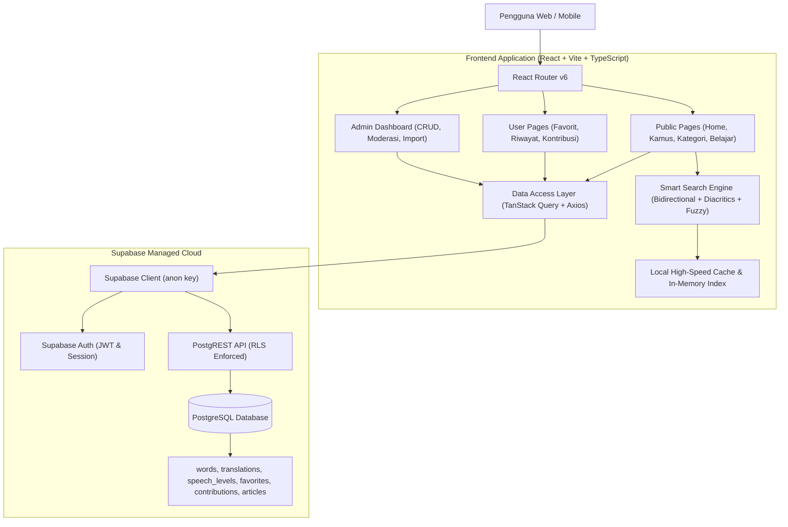
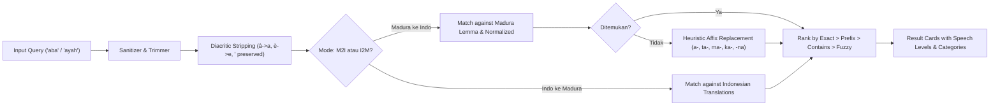

# System Architecture: Kamus Madura Digital

**Architecture Version:** 1.0.0  
**Status:** Approved Specification  

---

## 1. High-Level Architecture Overview

Kamus Madura Digital mengadopsi arsitektur **Modern Single-Page Application (SPA)** dengan integrasi **BaaS (Backend-as-a-Service) Supabase**. Arsitektur ini dirancang dengan prinsip *offline-first resilience*: aplikasi dilengkapi dataset leksikal lokal terkompresi yang siap melayani pencarian secara instan bahkan tanpa latensi jaringan, sementara Supabase mengelola persistensi akun pengguna, sinkronisasi favorit, riwayat pencarian, sistem kontribusi kosakata, serta admin dashboard.



---

## 2. Frontend Architecture & Design Tokens

### 2.1 Technology Stack
- **Framework:** React 18+ dengan Vite sebagai build tool dan TypeScript mode strict.
- **Styling:** Tailwind CSS dengan custom design tokens yang terinspirasi dari identitas budaya Madura (Navy & Gold, Dark Green, Warm Ivory).
- **Icons:** Lucide React (konsisten, modern, bebas emoji generik).
- **State & Data Fetching:** TanStack Query v5 untuk server state, local storage synchronization untuk preferensi dan offline cache.
- **Routing:** React Router v6 dengan struktur modular dan nested layouts (Public Layout, Admin Layout, Dashboard Layout).

### 2.2 Design Tokens & Color Palette
Berdasarkan PRD Section 7.2:
- **Primary:**
  - Deep Navy: `#172B3A`
  - Dark Green: `#1F5145`
- **Secondary:**
  - Warm Ivory: `#F8F7F2`
  - Soft Beige: `#EDE9DF`
- **Accent:**
  - Muted Gold: `#C5A66A`
- **Typography:**
  - Headings: Plus Jakarta Sans / Playfair editorial touch
  - Body: Inter
  - Monospace/Accents: JetBrains Mono

---

## 3. Bidirectional Search Pipeline



---

## 4. Security & Access Control (Least Privilege)

1. **Row Level Security (RLS):**
   - Tabel `words` & `word_translations`: Publik dapat membaca (`SELECT`), hanya Admin & Editor yang dapat menambah/mengedit/menghapus (`INSERT/UPDATE/DELETE`).
   - Tabel `favorites`: Pengguna hanya dapat mengakses record miliknya sendiri (`auth.uid() = user_id`).
   - Tabel `contributions`: Pengguna terdaftar dapat membuat usulan (`INSERT`), namun hanya Admin yang dapat membaca seluruhnya dan mengubah status review.
2. **Environment Variables:**
   - Frontend hanya menyimpan `VITE_SUPABASE_URL` dan `VITE_SUPABASE_ANON_KEY`.
   - `SERVICE_ROLE_KEY` tidak pernah di-expose ke sisi client browser.

---

## 5. Directory & File Organization

Sesuai spesifikasi PRD Section 13:
```
src/
├── app/
│   ├── layouts/     # RootLayout, PublicLayout, AdminLayout
│   ├── providers/   # QueryClientProvider, AuthProvider, ToastProvider
│   └── router/      # AppRouter.tsx with public & protected routes
├── components/
│   ├── common/      # Navbar, Footer, Breadcrumbs, EmptyState, Skeleton
│   ├── dashboard/   # MetricsCards, DataTable, WordModal
│   ├── dictionary/  # SearchBar, DirectionToggle, WordCard, SpeechBadge
│   └── ui/          # Button, Input, Modal, Dropdown, Badge, Tabs
├── features/
│   ├── admin/       # Dictionary CRUD, Moderasi kontribusi, Export/Import
│   ├── dictionary/  # Search logic, word detail, morphology rules
│   ├── learning/    # Artikel pembelajaran & tata bahasa
│   └── user/        # Favorit, Riwayat pencarian, Form kontribusi
├── lib/
│   ├── axios.ts     # Central HTTP client
│   ├── supabase.ts  # Supabase client singleton & auth helpers
│   └── utils.ts     # Diacritic normalization, slugify, cn helper
├── pages/
│   ├── admin/       # AdminDashboard, WordManagement, Contributions, BulkImport
│   ├── public/      # HomePage, DictionarySearchPage, WordDetailPage, KategoriPage
│   └── user/        # FavoritesPage, HistoryPage, ContributePage
└── types/           # TypeScript interfaces (Word, SpeechLevel, Category, etc.)
```
