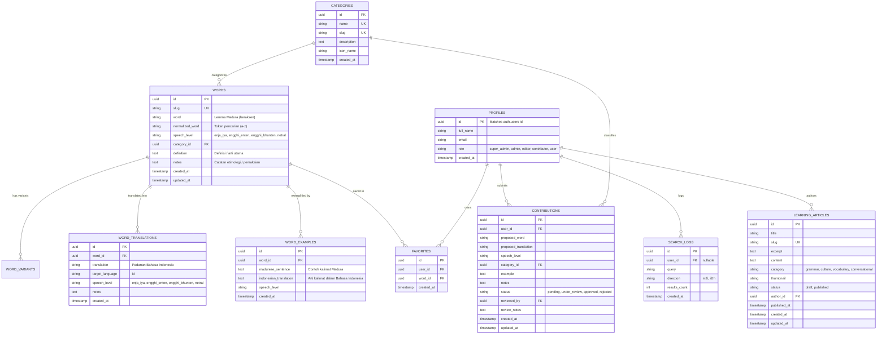

# Database Design Specification: Kamus Madura Digital

**Target DBMS:** PostgreSQL 15+ (via Supabase)  
**Schema Version:** 1.0.0  

---

## 1. Entity-Relationship Diagram (ERD)



---

## 2. Table Schemas & Column Definitions

### 2.1 `categories`
Menampung klasifikasi kelas kata dan tema kosakata:
- `id` (UUID, PK, `default gen_random_uuid()`)
- `name` (VARCHAR(100), NOT NULL, UNIQUE)
- `slug` (VARCHAR(100), NOT NULL, UNIQUE)
- `description` (TEXT)
- `icon_name` (VARCHAR(50))
- `created_at` (TIMESTAMPTZ, default `now()`)

### 2.2 `words`
Tabel entri utama leksikon Madura:
- `id` (UUID, PK, `default gen_random_uuid()`)
- `slug` (VARCHAR(255), NOT NULL, UNIQUE)
- `word` (VARCHAR(255), NOT NULL) - Entri kata Madura dengan ortografi baku beraksen.
- `normalized_word` (VARCHAR(255), NOT NULL) - Versi huruf kecil tanpa aksen (`a-z`) untuk indeks cepat.
- `speech_level` (VARCHAR(50), NOT NULL, DEFAULT `'netral'`) - Cek constraint: `enja_iya`, `engghi_enten`, `engghi_bhunten`, `netral`.
- `category_id` (UUID, FK ke `categories.id`, ON DELETE SET NULL)
- `definition` (TEXT, NOT NULL)
- `notes` (TEXT)
- `created_at` (TIMESTAMPTZ, default `now()`)
- `updated_at` (TIMESTAMPTZ, default `now()`)

### 2.3 `word_translations`
Dukungan satu kata Madura memiliki padanan jamak:
- `id` (UUID, PK, `default gen_random_uuid()`)
- `word_id` (UUID, NOT NULL, FK ke `words.id`, ON DELETE CASCADE)
- `translation` (VARCHAR(255), NOT NULL)
- `target_language` (VARCHAR(10), NOT NULL, DEFAULT `'id'`)
- `speech_level` (VARCHAR(50), DEFAULT `'netral'`)
- `notes` (TEXT)
- `created_at` (TIMESTAMPTZ, default `now()`)

---

## 3. Indexing & Optimization

```sql
-- Indeks B-Tree untuk query eksak dan slug
CREATE INDEX idx_words_slug ON words(slug);
CREATE INDEX idx_words_speech_level ON words(speech_level);
CREATE INDEX idx_words_category_id ON words(category_id);

-- Indeks Trigram untuk pencarian fuzzy dan wildcard
CREATE EXTENSION IF NOT EXISTS pg_trgm;
CREATE INDEX idx_words_normalized_trgm ON words USING gin (normalized_word gin_trgm_ops);
CREATE INDEX idx_translations_trgm ON word_translations USING gin (translation gin_trgm_ops);
```

---

## 4. Row Level Security (RLS) Policies

1. **`words` & `word_translations`:**
   - `SELECT`: `TRUE` (Publik dapat mencari dan membaca tanpa autentikasi).
   - `INSERT`, `UPDATE`, `DELETE`: Hanya `admin` atau `super_admin`.
2. **`favorites`:**
   - `SELECT`, `INSERT`, `DELETE`: `auth.uid() = user_id`.
3. **`contributions`:**
   - `INSERT`: Pengguna terautentikasi (`auth.uid() = user_id`).
   - `SELECT`: Pembuat usulan melihat miliknya, admin melihat semua usulan.
   - `UPDATE`: Hanya admin (untuk mengubah status persetujuan).
