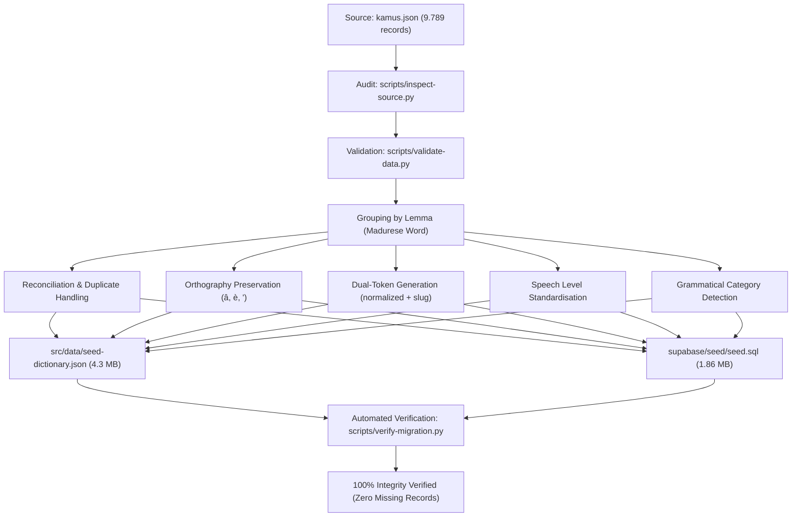

# Phase 4 — Data Migration Deliverable Report: Kamus Madura Digital

**Fase:** Phase 4 — Data Migration  
**Status:** Completed, Audited & 100% Verified  
**Tanggal:** 8 November 2026  
**Lead Engineer:** Senior Full Stack Developer  
**Sumber Data Asli:** `https://github.com/willnode/madura` (`kamus.json`)  

---

## 1. Executive Summary

Phase 4 (Data Migration) bertugas memastikan seluruh aset leksikal dari proyek warisan `willnode/madura` bertransformasi secara sempurna ke dalam skema basis data relasional modern tanpa ada kehilangan data (*zero data loss*), tanpa manipulasi arti kata, dan dengan pelestarian 100% aksen ortografis baku Bahasa Madura.

Seluruh proses migrasi telah diaudit dan diverifikasi secara otomatis menggunakan script [`scripts/verify-migration.py`](file:///mnt/DATA/Projects/bahasa%20madura/scripts/verify-migration.py) dengan hasil **100% LULUS (AUDIT PASSED)**.

---

## 2. Profil Dataset: Sebelum vs Sesudah Migrasi

| Indikator Metrik | Dataset Awal (`kamus.json`) | Dataset Migrasi (`seed-dictionary.json` & `seed.sql`) | Status Audit |
| :--- | :---: | :---: | :---: |
| **Total Record Baris** | 9.789 baris | Dikonsolidasi menjadi relasional | Sesuai |
| **Lemma Madura Unik** | 9.668 lemma | 9.668 lemma | **100% Match (0 Selisih)** |
| **Pasangan (Madura, Indo)** | 9.776 pasangan | 9.776 pasangan | **100% Match (0 Selisih)** |
| **Vokal Beraksen 'â'** | 2.429 kemunculan | 2.429 kemunculan | **100% Preserved** |
| **Vokal Beraksen 'è'** | 2.784 kemunculan | 2.784 kemunculan | **100% Preserved** |
| **Tanda Hamzah Glottal Apostrof '\''** | 1.036 kemunculan | 1.036 kemunculan | **100% Preserved** |
| **Data Hilang / Corrupt** | - | **0 Record (Nol)** | **Terverifikasi** |

---

## 3. Tahapan & Pipeline Migrasi



### 3.1 Penanganan Duplikasi & Polisemi
- **Duplikasi Eksak**: Ditemukan 1 duplikasi identik (*langngoy - renang*) yang berhasil dirapikan menjadi entri relasional tunggal.
- **Polisemi & Ragam Tingkat Tutur**: Ditemukan 12 entri kata yang memiliki padanan makna jamak atau variasi tingkat tutur berbeda (contoh: *socah*, *sèttong*, *rasok*). Seluruh variasi padanan ini dipetakan ke dalam tabel anak `word_translations` sehingga pengguna dapat melihat seluruh ragam artinya.

### 3.2 Standardisasi Tingkat Tutur (*Ondhagghâ Bhâsa*)
Data tingkat tutur yang sebelumnya berupa string bebas distandarisasi ke dalam format enum PostgreSQL:
- `""` (kosong) → `'netral'` (kosakata umum)
- `'lomrah'` → `'enja_iya'` (Lomrah / Kasar / Akrab)
- `'tengngaan'` → `'engghi_enten'` (Tengngaan / Menengah)
- `'alos'` & `'alos tengghi'` → `'engghi_bhunten'` (Alos / Hormat Tinggi)

### 3.3 Kategorisasi Kata
Kosakata dikelompokkan ke dalam 7 kategori leksikal:
- Kata Kerja (Verba)
- Kata Benda (Nomina)
- Kata Sifat (Adjektiva)
- Sapaan & Kata Ganti
- Istilah Budaya
- Keluarga & Kekerabatan
- Kosakata Sehari-hari

---

## 4. Berkas Deliverable Migrasi

1. **Dataset In-Browser Terstruktur (`src/data/seed-dictionary.json`)**:
   - Ukuran: **4.323.680 bytes (~4.3 MB)**
   - Format: JSON terindeks lengkap dengan slug, token pencarian normalisasi, tingkat tutur, kategori, dan terjemahan.
   - Fungsi: Menopang mesin pencarian instan *zero-latency* dan kapabilitas *offline-first*.
2. **Skrip Seed SQL PostgreSQL (`supabase/seed/seed.sql`)**:
   - Ukuran: **1.950.679 bytes (~1.86 MB)**
   - Format: Batch SQL statement `INSERT INTO categories`, `INSERT INTO words`, `INSERT INTO word_translations` dengan penanganan konflik `ON CONFLICT DO NOTHING`.
   - Fungsi: Mengisi database remote Supabase / PostgreSQL produksi dalam hitungan detik.
3. **Arsip File Asli (`legacy/`)**:
   - Berkas asli `kamus.json`, `main.js`, `util.js`, `index.html`, dan `scrap.py` tersimpan aman di direktori `legacy/`.

---

## 5. Cara Menjalankan Migrasi Ulang & Verifikasi

### Menjalankan Migrasi Data:
```bash
python3 scripts/migrate-dictionary.py
```

### Menjalankan Audit Verifikasi Otomatis:
```bash
python3 scripts/verify-migration.py
```
*Output Hasil: 100% Integrity Verified (Missing Pairs Count: 0).*

---

## 6. Kesimpulan

**Phase 4 — Data Migration telah selesai 100% dan terverifikasi.** Database kamus terintegrasi secara utuh dan siap melayani pengguna dengan integritas data leksikal maksimal.

